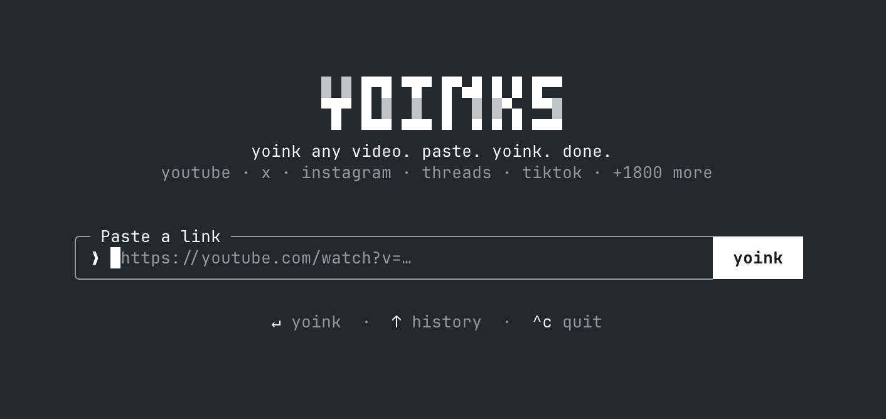
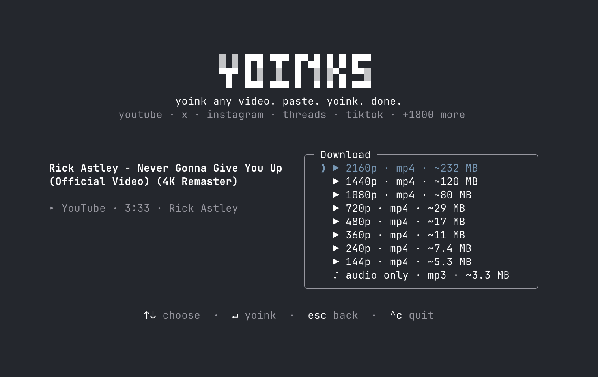

# yoinks

<picture>
  <source media="(prefers-color-scheme: dark)" srcset="assets/logo-dark.svg">
  
</picture>

yoink any video. paste. yoink. done.

Download videos from YouTube, X/Twitter, Instagram, Threads, TikTok and
1,800+ other sites — right from your terminal. Paste a url, pick a
resolution (or audio-only mp3), done. No popups, no fake download buttons,
no sketchy redirects.



## Install

```sh
npm install -g yoinks
```

Or try it without installing anything:

```sh
npx yoinks
```

On macOS and Linux you can also install straight from this repo:

```sh
curl -fsSL https://raw.githubusercontent.com/georgehadji/Downloader/main/install.sh | sh
```

It clones to `~/.yoinks/app`, builds, and links `~/.local/bin/yoinks`. Run it
again to update. On Windows, use the development steps below
(`npm install`, `npm run build`, `npm link`).

Requires Node 22+. Everything else (yt-dlp, ffmpeg) is fetched or bundled
automatically.

## Usage

```sh
$ yoinks https://youtu.be/dQw4w9WgXcQ    # straight to the format picker
$ yoinks                                 # prompts for a url
$ yoinks --theme light                   # force the light palette
$ yoinks -o ~/Videos <url>               # save somewhere other than ~/Downloads
```

### Scriptable mode

`--best` and `--mp3` skip the picker, download, print the saved file path to
stdout (progress and messages go to stderr) and exit. The exit code is `0` on
success and `1` on any failure.

```sh
$ yoinks --best https://youtu.be/dQw4w9WgXcQ            # best quality, mp4
$ yoinks --mp3 -o ~/Music https://youtu.be/dQw4w9WgXcQ  # audio only
$ file=$(yoinks --best <url>)                           # capture the path
$ yoinks --mp3 --playlist <playlist-url>                # every video, one path per line
```

With `--playlist`, videos that fail (private, removed) are skipped; the rest
are saved and yoinks exits `1` with the reason on stderr. In the interactive
app a playlist link shows a message pointing you to `--playlist`.

Something failing with too little detail? `YOINKS_DEBUG=1 yoinks …` appends
yt-dlp's command line and full output to `~/.yoinks/debug.log`.

yoinks takes over the terminal (full-screen, centered — and restores your
scrollback on exit). Pick a format with ↑/↓ (or j/k, or number keys) and
hit enter. `esc` goes back, `^c` quits. Or just use the mouse — the yoink
button, the format list and the footer hints are all clickable, and
clicking the logo takes you back home. Files are saved to `~/Downloads`,
and the file path is printed to your terminal when you're done.

The default `auto` theme uses your terminal's own foreground and background,
so it follows light and dark terminal themes without guessing. Press `^t` or
click the theme control in the footer to cycle through `auto`, `light`, and
`dark` for the current session. Use `--theme auto`, `--theme light`, or
`--theme dark` to choose the starting theme for one launch.



## How it works

- Powered by [yt-dlp](https://github.com/yt-dlp/yt-dlp). On first run,
  yoinks downloads the standalone yt-dlp binary to `~/.yoinks/bin` —
  no Python required. If you already have yt-dlp installed, it uses yours.
- ffmpeg (needed for merging high-res streams and mp3 extraction) is found
  on your PATH, with `ffmpeg-static` as a bundled fallback.
- The UI is [Ink](https://github.com/vadimdemedes/ink) — React for the
  terminal.

## Development

```sh
npm install
npm run build        # bundle to dist/ with tsup
npm run dev          # rebuild on change
node dist/cli.js <url>
npm run typecheck
npm test
```

To try it as a global command without publishing: `npm link`, then run
`yoinks` anywhere.

## Roadmap

- [x] `--best` / `--mp3` flags to skip the picker (scriptable mode)
- [x] `-o <dir>` to choose the output folder
- [x] Playlist support in scriptable mode (`--playlist`)
- [ ] Playlist picker in the interactive app
- [x] Clipboard detection: launch bare and auto-suggest the url you copied
- [x] Self-update for the bundled yt-dlp binary (`yt-dlp -U`)
- [x] Publish to npm (`npm i -g yoinks` / `npx yoinks`)
- [x] `curl … | sh` installer (macOS/Linux; `install.sh`)

## A note on fair use

yoinks is a personal-archiving tool. Downloading content may violate a
platform's terms of service — only download what you have the right to
keep, and be excellent to creators.

## License

[MIT](LICENSE)
